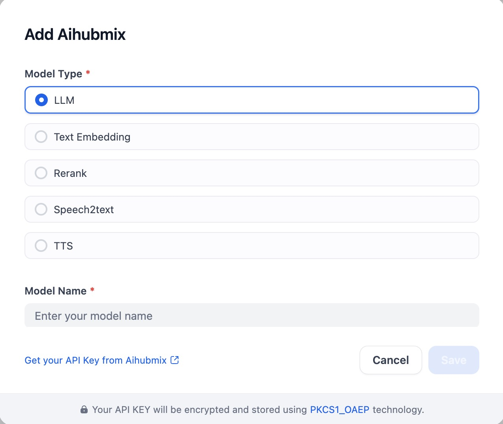

## Overview

Access every major LLM through a single, unified interface. Build smarter, faster.

- **Full Model Coverage**: Connect to all leading AI models including ChatGPT, Claude, Gemini, DeepSeek, and Qwen—all through one consistent format.
- **Unlimited Concurrency**: As authorized partners of Azure, AWS, and Google Cloud, we integrate official APIs alongside our proprietary services for enterprise-grade reliability and unlimited throughput.
- **Enterprise-Ready Performance**: Built on high-performance infrastructure with proven stability in production environments across multiple industries.

## Configure
With the plugin installed, configure AiHubmix by providing the Model Type, Model Name, AiHubmix Endpoint, and API Key. Save in Model Provider.

Get your API key from the [AiHubMix console](https://console.aihubmix.com/token).
For a step-by-step walkthrough of this plugin, see the **[Dify integration guide](https://docs.aihubmix.com/en/clients/Dify)** ([中文版](https://docs.aihubmix.com/cn/clients/Dify)).

## Links

- [aihubmix.com](https://aihubmix.com) — website, live model catalog and pricing
- [docs.aihubmix.com](https://docs.aihubmix.com) — full documentation

## Kimi K3.1 Pro

Select `kimi-k3.1-pro` or `kimi-k3.1-pro-highspeed` for the new Kimi release.
Both use always-on thinking with `low`, `high`, or `max` reasoning effort.
Model limits follow the [Kimi API guide](https://platform.kimi.ai/docs/guide/kimi-k3-1-pro-quickstart);
pricing follows AiHubMix's [Pro](https://aihubmix.com/model/kimi-k3.1-pro) and
[Highspeed](https://aihubmix.com/model/kimi-k3.1-pro-highspeed) listings.
These definitions have been validated locally; live gateway capabilities have not been tested.
