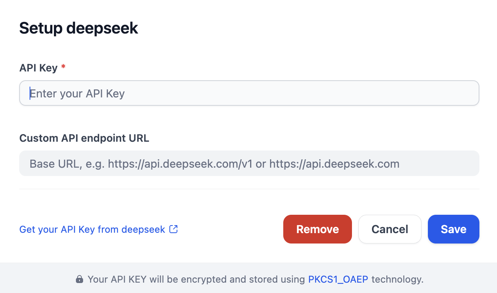

# Overview

This plugin integrates the official `deepseek-flash` and `deepseek-v4-pro` models
through the Chat Completions API. The display name `deepseek-flash` follows the
stable API ID rather than a specific model version: DeepSeek may upgrade the model
behind that ID without requiring a new selection in Dify.

Both models support a 1,048,576-token context and up to 393,216 output tokens,
including reasoning. `deepseek-flash` accepts text and images; `deepseek-v4-pro`
accepts text. Thinking is enabled by default, with `high` effort; choose `low`,
`high`, or `max`, or disable Thinking Mode for a direct answer.
The `deepseek-flash` entry defaults to a 65,536-token output limit.

For Flash, `top_p` applies only in thinking mode, from 0.95 to 1.0; `temperature`
applies only in non-thinking mode. For Pro, `top_p` applies in non-thinking mode
and is ignored in thinking mode. See the
[Chat Completions reference](https://api-docs.deepseek.com/api/create-chat-completion)
and [Thinking Mode guide](https://api-docs.deepseek.com/guides/thinking_mode).

The legacy IDs `deepseek-v4-flash` and `deepseek-v4-flash-vision-exp` remain
available with `deprecated: false`, so existing apps can keep their model selection.
They retain their 4,096-token output defaults and use the current Flash sampling
rules. The plugin sends the selected API ID unchanged. Select `deepseek-flash`
when configuring the current Flash model explicitly.
Credential validation uses `deepseek-flash`.

Images can be supplied as URLs or inline Base64 in user and tool messages.
Supported formats are JPEG, PNG, GIF, and WebP; see the
[vision guide](https://api-docs.deepseek.com/guides/vision) for request limits.
Local token estimates exclude images; the API's returned usage includes them.

Pricing varies by cache status and time window; refer to the
[official pricing page](https://api-docs.deepseek.com/quick_start/pricing/).

# Built-in web tools

For `deepseek-flash` (including the two legacy Flash IDs), enable **Web Search**
(`deepseek_web_search`) and/or **Read URLs** (`deepseek_read_url`) in the model
parameters. Both are off by default. DeepSeek executes these tools on the server;
they can coexist with Dify function tools and work with streaming and non-streaming
responses. These options are not exposed for `deepseek-v4-pro`.

**Client function tools combined with either web tool, high safety checking,
or enabled title generation require thinking mode.** The plugin automatically
enables thinking for these combinations, even if the Thinking Mode switch is
off, and applies thinking-mode sampling rules. This can increase latency and
reasoning token usage. Without client function tools, the selected Thinking Mode
setting is retained. Disabled title generation and `low` safety checking are
omitted from the request (the API defaults are equivalent), so ordinary function
tools can still run in non-thinking mode when no Chatbot extensions are enabled.

Web Search uses deep search when Thinking Mode is enabled. Read URLs considers
links in the last user message; when thinking and web search are both enabled,
deep search takes precedence over separate link reading. The model decides when
to use the tools. `tool_choice: none` disables all tools. Web tools require the
`text` response format; JSON output is incompatible with them. Search, image
search, and page fetches incur separate API charges in addition to token usage.
See the [web tools guide](https://api-docs.deepseek.com/zh-cn/guides/web_tools/).

The plugin preserves `server_tool_calls`, including encrypted page signatures,
in the assistant message's `opaque_body` and sends them back in subsequent
requests. Dify or a gateway must retain this opaque metadata in stored history
to retain previously read webpages. Streaming history replays only the final
step's reasoning as `reasoning_content`; earlier reasoning stays in its server
tool steps. Server calls are not returned as client function calls.

`annotations` (URL citations), `title`, `refusal`, and `usage.server_tool_use`
(tool invocation counts) are also preserved in `opaque_body`, with invocation
counts under `server_tool_use`. Streaming metadata is carried by the final
chunk. This plugin does not render citation markers or tool progress in the
Dify UI, automatically rename Dify conversations, or include tool charges in
Dify's token-based cost estimate. Citation offsets refer to the API's answer
text, excluding the plugin's displayed `<think>` block.

# Other API updates checked (2026-11-14)

- Flash now exposes **Content Safety Check** (`safety_check`, `low` or `high`)
  and **Generate Conversation Title** (`title`, off by default). The plugin
  converts these parameters to the API's object format. See the
  [safety](https://api-docs.deepseek.com/zh-cn/guides/safety/) and
  [conversation title](https://api-docs.deepseek.com/zh-cn/guides/conversation_title/)
  guides.
- The API accepts `reasoning_effort: none` to disable thinking when `thinking`
  is omitted or null; an explicit `thinking` setting takes precedence. Dify's
  model parameters continue to expose a separate Thinking Mode switch and
  `low` / `high` / `max` effort choices.
- The current model IDs, 1M context, 384K output limit, Flash vision support,
  and sampling rules were already covered by this plugin. Pro's and the legacy
  Flash entries' existing 4,096-token output defaults are retained for compatibility.
- [Files API and document parsing](https://api-docs.deepseek.com/zh-cn/guides/document_parsing/),
  [user metadata (`latest_reminder`)](https://api-docs.deepseek.com/zh-cn/guides/latest_reminder/),
  standalone Search/Fetch/OCR/TTS/ASR APIs, and Responses/Messages protocol support
  are additional API capabilities, not implemented by this Chat Completions
  model plugin. Document parsing needs a separate upload/parse lifecycle; images
  supplied directly in user and tool messages remain supported.

# Configure

Get an API key from [DeepSeek](https://platform.deepseek.com/api_keys), then
configure it under Settings → Model Provider.

