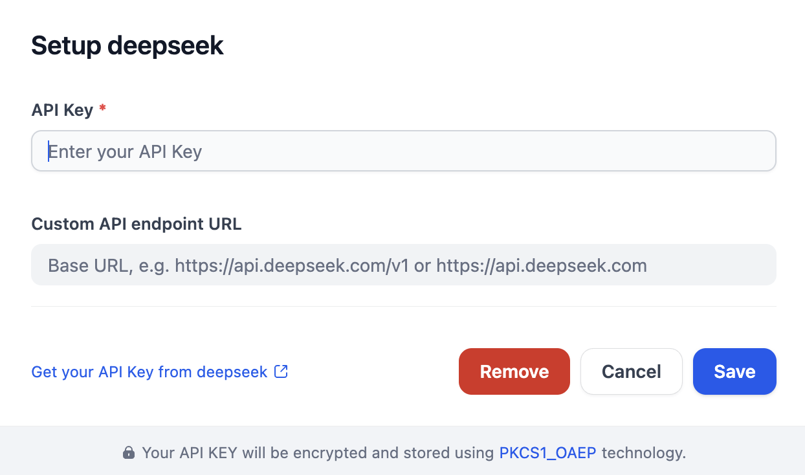

# Overview

This plugin integrates the official `deepseek-flash` and `deepseek-v4-pro` models
through the Chat Completions API. The display name `deepseek-flash` follows the
stable API ID rather than a specific model version: DeepSeek may upgrade the model
behind that ID without requiring a new selection in Dify.

Both models support a 1,048,576-token context and up to 393,216 output tokens,
including reasoning. `deepseek-flash` accepts text and images; `deepseek-v4-pro`
accepts text. Thinking is enabled by default, with `high` effort; choose `low`,
`high`, or `max`, or disable Thinking Mode for a direct answer.
The `deepseek-flash` entry defaults to a 65,536-token output limit.

For Flash, `top_p` applies only in thinking mode, from 0.95 to 1.0; `temperature`
applies only in non-thinking mode. For Pro, `top_p` applies in non-thinking mode
and is ignored in thinking mode. See the
[Chat Completions reference](https://api-docs.deepseek.com/api/create-chat-completion)
and [Thinking Mode guide](https://api-docs.deepseek.com/guides/thinking_mode).

The legacy IDs `deepseek-v4-flash` and `deepseek-v4-flash-vision-exp` remain
available with `deprecated: false`, so existing apps can keep their model selection.
They retain their 4,096-token output defaults and use the current Flash sampling
rules. The plugin sends the selected API ID unchanged. Select `deepseek-flash`
when configuring the current Flash model explicitly.
Credential validation uses `deepseek-flash`.

Images can be supplied as URLs or inline Base64 in user and tool messages.
Supported formats are JPEG, PNG, GIF, and WebP; see the
[vision guide](https://api-docs.deepseek.com/guides/vision) for request limits.
Local token estimates exclude images; the API's returned usage includes them.

Pricing varies by cache status and time window; refer to the
[official pricing page](https://api-docs.deepseek.com/quick_start/pricing/).

# Configure

Get an API key from [DeepSeek](https://platform.deepseek.com/api_keys), then
configure it under Settings → Model Provider.

