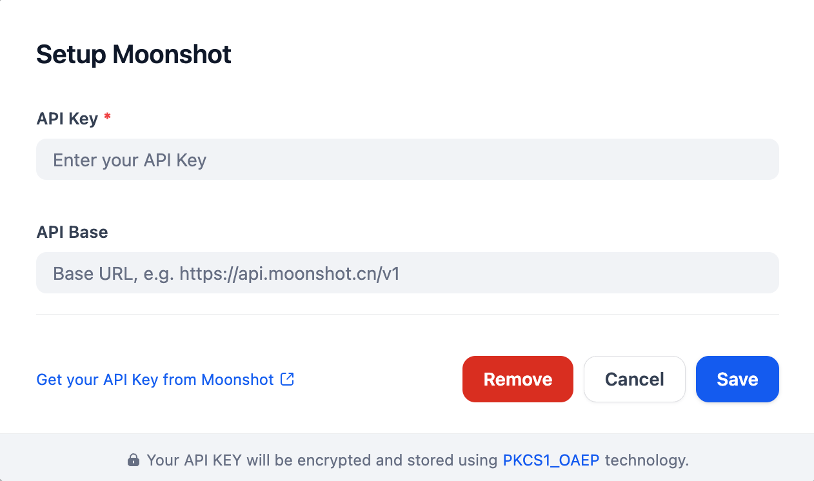

## Overview
This plugin provides access to Moonshot's Kimi LLM series, offering LLMs with different context lengths and intelligence for generating diverse text outputs. The API supports function calling, enabling developers to connect tools in AI applications.
Read https://platform.moonshot.ai/ to learn more about Kimi LLM series.

Kimi K3.1 Pro and Kimi K3.1 Pro Highspeed support a 1,048,576-token context,
image and video inputs, tool calling, and structured output. Both always use
thinking mode; select `low`, `high`, or `max` (default) with `reasoning_effort`.
`max_completion_tokens` defaults to 131,072 and supports up to 1,048,576 tokens.
See the [Kimi K3.1 Pro API guide](https://platform.kimi.ai/docs/guide/kimi-k3-1-pro-quickstart).
The model definitions use mainland RMB input/output pricing from the
[Kimi API platform](https://platform.kimi.com/); cache charges are billed separately.

## Configure

After installing the plugin, configure the API key and API base within the Model Provider settings. Obtain your API key from here. Save to use Kimi model.
Please note that there are two different API base for China and international access.

