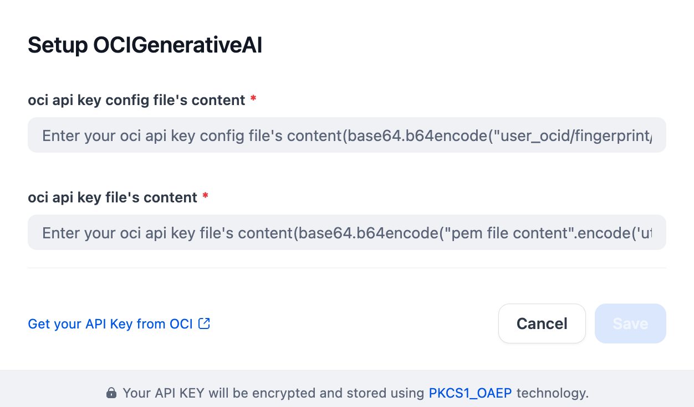

## Overview

[OCI Generative AI](https://www.oracle.com/artificial-intelligence/generative-ai/generative-ai-service/) is a fully managed service that serves pre-trained foundation models from Cohere, Google, Meta, OpenAI and xAI through a single API. This plugin exposes the on-demand catalog to Dify as three model types:

| Model type | Models | OCI API |
| --- | --- | --- |
| LLM | xAI Grok 4.7 / 4.6 / 4.3 / 4.20 (reasoning and non-reasoning), Google Gemini 2.5 Pro / Flash / Flash-Lite, OpenAI gpt-oss-120b / 20b, Cohere Command A and Command A Vision, Meta Llama 4 Maverick / Scout and Llama 3.3 70B | `chat` |
| Text embedding | Cohere Embed 4 (`cohere.embed-v4.0`, text and image inputs) | `embedText` |
| Rerank | Cohere Rerank 4 Fast (`cohere.rerank-v4.0-fast`) | `rerankText` |

All models are called in **on-demand** serving mode. Models that OCI only serves on dedicated AI clusters (for example `cohere.command-a-reasoning`, `cohere.rerank-v4.0-pro` and `cohere.rerank.v3-5`) are not listed because the plugin does not create or target dedicated endpoints. Check the [models-by-region](https://docs.oracle.com/en-us/iaas/Content/generative-ai/model-endpoint-regions.htm) page for the regions where each model is available on-demand; `us-chicago-1` has the widest coverage.

Model ids that OCI has already retired on-demand (Grok 3.x and Grok 4, Command R / R+ 08-2024, Llama 3.1 405B, Llama 3.2 90B Vision and the Cohere Embed 3 family) stay in the plugin flagged as deprecated: existing apps keep resolving them, but they are struck through in the model picker and new selections should move to the replacements OCI documents on the [retirement page](https://docs.oracle.com/en-us/iaas/Content/generative-ai/deprecating-on-demand.htm).

## Configure

After installing the plugin, open **Settings → Model Provider → OCI Generative AI** and fill in:

- **Default Region** – the OCI region identifier to send inference requests to, e.g. `us-chicago-1`.
- **Compartment OCID** – the compartment that is billed for the requests. Your IAM policy must allow `generative-ai-family` usage in it.
- **Authentication Method**
  - *API Key Authentication* – paste the User OCID, Tenancy OCID, key fingerprint and the private key file content of an [API signing key](https://docs.oracle.com/iaas/Content/API/Concepts/apisigningkey.htm).
  - *Instance Principal Authentication* – use this when Dify runs on an OCI compute instance or OKE node that is a member of a dynamic group with Generative AI permissions; no key material is stored in Dify.

Once saved you can use the OCI models in apps, workflows, knowledge-base embedding and the rerank step of retrieval.

## Notes

- **Reasoning effort** – Grok 4.7, 4.6, 4.3 and 4.20 (reasoning) expose a `reasoningEffort` parameter (`LOW` / `MEDIUM` / `HIGH`). Leave it unset to use the service default.
- **Vision** – Command A Vision, Grok 4.3 / 4.20, Llama 4 and Gemini accept images in the prompt. Command A Vision is served through the Cohere v2 chat format, which the plugin selects automatically.
- **Embed 4** – returns 1536-dimensional vectors by default; OCI also offers 256 / 512 / 1024 dimensions through the `outputDimensions` request field, which Dify's embedding interface does not expose. Requests are batched 48 inputs at a time (OCI accepts up to 96).
- **Rerank 4 Fast** – OCI limits one request to `documents x maxChunksPerDocument <= 10000`; the plugin reranks in batches of 1000 documents and merges the results by relevance score.
- **Pricing** – the `pricing` blocks hold the standard-tier, short-context list price per model. Long-context, cached-input and priority-processing tiers (Grok) and the per-search-unit price of rerank are not representable in Dify's price schema; see the [OCI price list](https://www.oracle.com/cloud/price-list/#genai).
