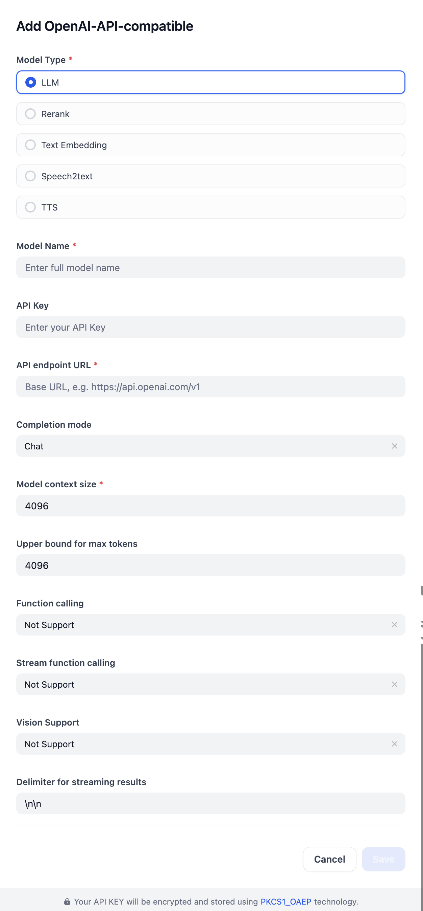

## Overview

This plugin provides access to models that are OpenAI-compatible, including LLMs, reranking, text embedding, speech-to-text (STT), and text-to-speech(TTS) models. Developers can easily add models by providing configuration parameters such as the model name and API key.

## Configure

Configure the OpenAI-API-compatible model by providing its core details (Type, Name, API Key, URL) and adjusting further options like completion, context, and token limits, as well as streaming and vision settings. Save when done.

### TokenLab example

TokenLab can be configured through this plugin with the OpenAI-compatible API surface:

| Field | Value |
| --- | --- |
| Type | `LLM` |
| Model Name | `gpt-5.4-mini` |
| API Key | Your TokenLab API key |
| API Base URL | `https://api.tokenlab.sh/v1` |
| Completion mode | `Chat` |

Use `https://api.tokenlab.sh/v1` for LLM/chat models. For non-LLM model types where this plugin appends the API version internally, such as text embedding, rerank, STT, and TTS, use `https://api.tokenlab.sh` instead to avoid a duplicated `/v1/v1` path.

Other TokenLab chat models can be added the same way, for example `gpt-5.5`, `claude-opus-4-8`, `claude-sonnet-5`, `gemini-3.5-flash`, `grok-4.3`, `qwen3.7-max`, `deepseek-v4-pro`, `deepseek-v4-flash`, `glm-5.2`, `minimax-m3`, and `kimi-k2.7-code`.

TokenLab also provides native endpoint families such as Responses, Anthropic Messages, and Gemini-compatible APIs. This OpenAI-API-compatible plugin uses TokenLab's `/v1` OpenAI-compatible endpoint.

### Hubris example

[Hubris](https://hubris.pw) is a ruble-billed OpenAI-compatible LLM gateway (400+ models) that can be configured through this plugin:

| Field | Value |
| --- | --- |
| Type | `LLM` |
| Model Name | `claude-sonnet-5` |
| API Key | Your Hubris API key (create at [hubris.pw/keys](https://hubris.pw/keys)) |
| API Base URL | `https://api.hubris.pw/v1` |
| Completion mode | `Chat` |

Other Hubris models can be added the same way — see the full catalog at [hubris.pw/models](https://hubris.pw/models).

### TokenSail example

[TokenSail](https://tokensail.ai) provides an OpenAI-compatible gateway for DeepSeek, Qwen, GLM and Kimi model families, with USD billing. Model IDs and their capabilities are listed at [tokensail.ai/models](https://tokensail.ai/models); the table below uses `deepseek-v4-pro` as one example.

| Field | Value |
| --- | --- |
| Type | `LLM` |
| Model Name | `deepseek-v4-pro` |
| API Key | Your TokenSail API key |
| API Base URL | `https://api.tokensail.ai/v1` |
| Completion mode | `Chat` |

Keep `/v1` in the base URL for every model type — the version-less base returns HTTP 503. Chat, embedding and rerank all resolve under `https://api.tokensail.ai/v1`, and rerank answers on its default endpoint path, so no endpoint override is needed.

`glm-5.3` requires thinking to remain on: requests that disable thinking are rejected with HTTP 400, so do not apply a "disable thinking" setting across every TokenSail model.
