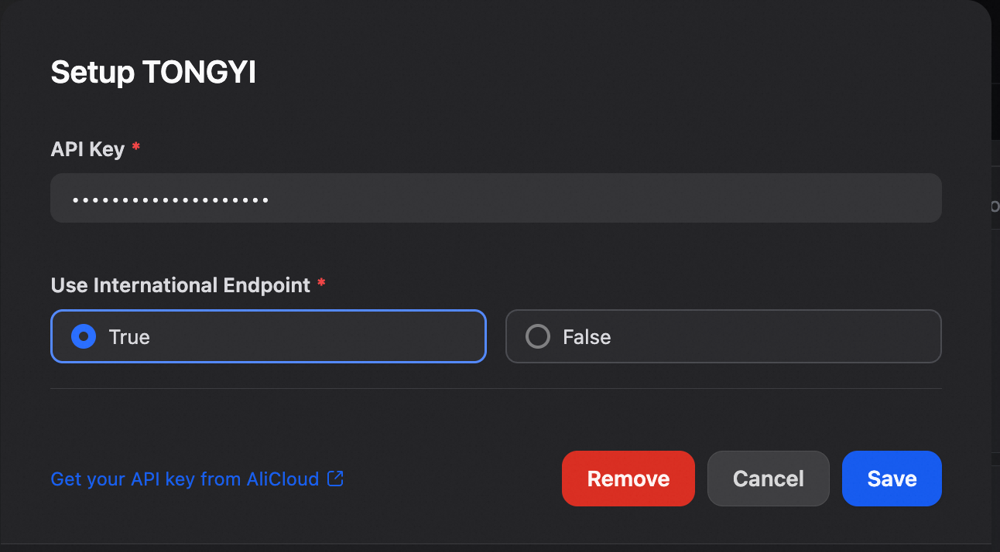

# Overview
Tongyi Qwen, developed by Alibaba Cloud, is a sophisticated series of LLMs. It includes multiple variants, such as Qwen for text processing, Qwen-VL for vision-language tasks, and Qwen-Audio for audio understanding. The models are notable for their impressive scale, with the flagship Qwen-72B model featuring 72 billion parameters and trained on over 3 trillion tokens.

# Configure
After installation, you need to get API keys from [Alibaba Cloud](https://bailian.console.aliyun.com/?apiKey=1#/api-key) and setup in Settings -> Model Provider.

## Model catalog update (0.2.23)

Provider credential validation now uses `qwen3.8-flash`, which is available in
Beijing and Singapore, instead of the retired `qwen-turbo`. Existing
`validate_model` overrides are still honored for keys restricted to another model.

The predefined catalog was checked against Alibaba Cloud's retirement notices on
October 13, 2026. Retired model definitions and their ordering entries have been
removed, including older snapshots and their legacy short-date aliases. Existing
apps using these models need to select a supported replacement; their model IDs
are not automatically rewritten.

| Retired models | Available replacements | Official notice |
| --- | --- | --- |
| Qwen-Turbo (including the plugin's `qwen-turbo-chat` alias), Qwen-VL-Max/Plus, QwQ/QVQ and older math/coder models | `qwen3.8-flash`, `qwen3.7-plus`, `qwen3.8-max` | [Mainline retirements](https://www.aliyun.com/notice/118177) |
| Qwen3-Max/preview, Qwen3-VL-Flash and Qwen3-Coder-Plus | Qwen3.7 and Qwen3.8 models | [Mainline retirements](https://www.aliyun.com/notice/118344) |
| Older Qwen3, DeepSeek, Kimi and GLM snapshots | Qwen3.7/Qwen3.8 models or a supported model from the same provider | [Snapshot retirements](https://www.aliyun.com/notice/118345) |
| Qwen-Math-Plus, Qwen-MT-Turbo, DeepSeek-V4-Flash preview and other listed legacy models | Newly added `qwen-mt-flash` for translation; `deepseek-v4-flash-0731` or `deepseek-v4.1-flash` for DeepSeek | [Legacy retirements](https://www.aliyun.com/notice/118434) |
| Older Qwen Max/Plus/Turbo and VL snapshots | Current Qwen models | [January snapshot retirements](https://www.aliyun.com/notice/117814) |
| `paraformer-realtime-v1` | `paraformer-realtime-v2` | [Speech model retirements](https://www.aliyun.com/notice/118331) |
| `qwen-max-longcontext` | `qwen-max` or current Qwen models | [Platform release notes](https://help.aliyun.com/zh/model-studio/model-release-notes) |

See the current [model catalog](https://help.aliyun.com/zh/model-studio/models),
[Qwen3.8-Flash specifications](https://help.aliyun.com/zh/model-studio/qwen3-8-flash),
and [Qwen-MT-Flash specifications](https://help.aliyun.com/zh/model-studio/qwen-mt-flash).
Model availability depends on the API key's region and permissions.

# Speech-to-text runtime note

Tongyi speech-to-text patches DashScope's async-to-sync websocket bridge when it runs under Dify's gevent-based plugin runtime. This avoids sustained high CPU after STT requests while keeping the normal in-process recognition path.

If you need stronger isolation for STT recognition, set `TONGYI_STT_SUBPROCESS=1` in the plugin daemon environment.
`TONGYI_STT_RECOGNITION_TIMEOUT` can be used to tune the subprocess timeout.

## Request metadata

`Enable request metadata` is optional and disabled by default. Turning it on attaches `X-Dify-App-Id` and `X-Dify-Source` to each Tongyi request as custom HTTP headers, so usage can be attributed to a specific Dify app in the DashScope server logs. The opt-in is composed with the existing bury-point header (which carries market analytics) in a single merged headers dict before the call to `Generation.call` or `MultiModalConversation.call`. The Dify session lookup is best-effort: if the session context is not initialized, no Dify headers are attached and only the bury-point header is sent.
