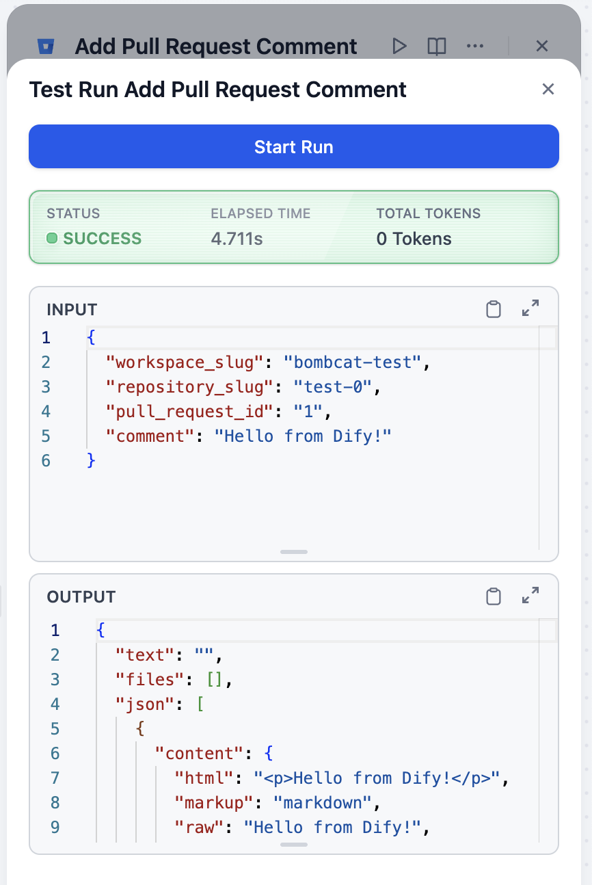
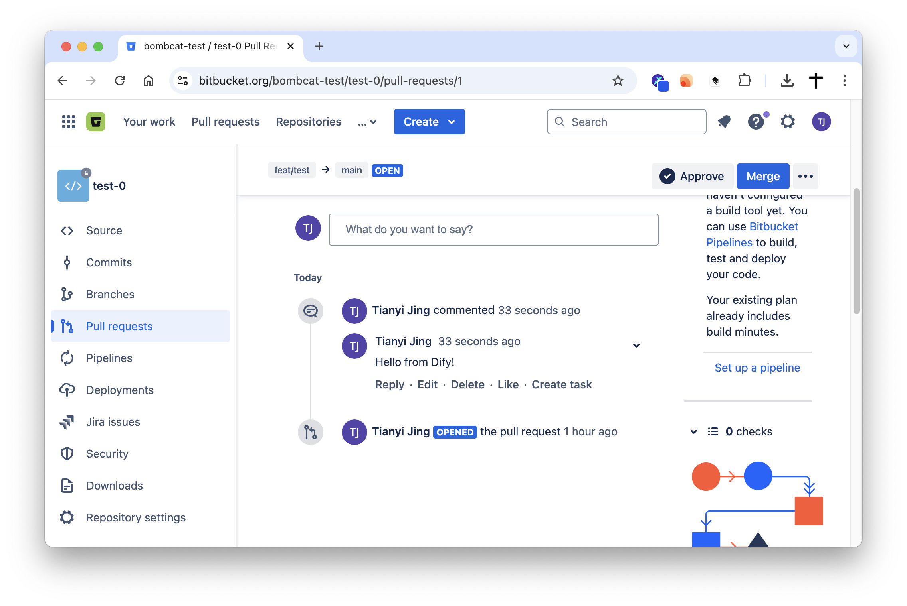

## Dify Plugin for Bitbucket

### Description

This Dify plugin allows you to interact with the Bitbucket API, enabling you to perform various actions such as acquiring info from repositories, projects, pull requests. The plugin is designed to facilitate seamless integration with Bitbucket's features and functionalities.

### Tools

### Features

This plugin provides the following functionalities:

*   **Workspace Management:**
    *   List accessible workspaces (`list_workspace`).
    *   Get details of a specific workspace (`get_workspace`).
*   **Repository Management:**
    *   List repositories within a workspace (`list_repository`).
    *   Get details of a specific repository (`get_repository`).
*   **Pull Request Management:**
    *   List pull requests in a repository (`list_pull_request`).
    *   Get details of a specific pull request (`get_pull_request`).
    *   Add comments to a pull request (`add_pull_request_comment`).

### Setup

1. [Create an API token with scopes for Bitbucket Cloud](https://support.atlassian.com/bitbucket-cloud/docs/create-an-api-token/).
2. Add `read:workspace:bitbucket`, `read:repository:bitbucket`, and `read:pullrequest:bitbucket` for the read tools. Add `write:pullrequest:bitbucket` if the workflow posts pull request comments.
3. Enter `https://api.bitbucket.org` as the API URL in Dify. Authenticate with your Atlassian account email and the scoped token. Update any saved App Password credentials.

    
    

### Privacy Policy

Check the [Privacy Policy](PRIVACY.md) for more information on how we handle your data.
