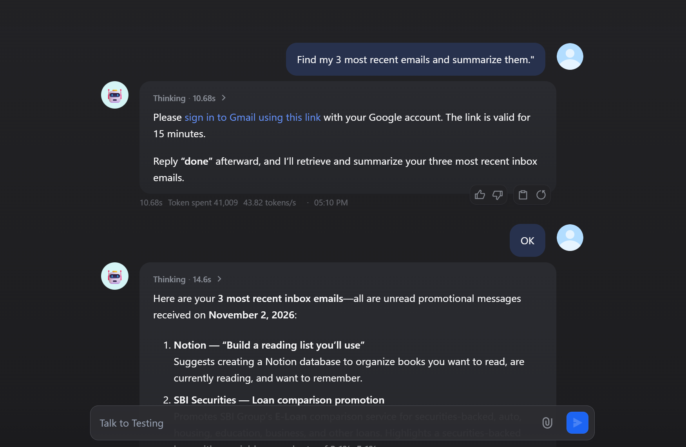
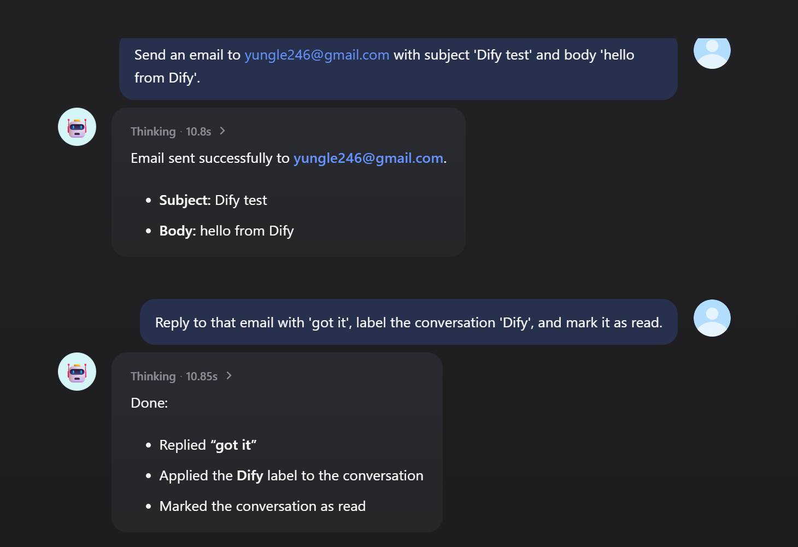

# Dify Gmail Plugin

A comprehensive Gmail integration plugin for Dify that provides essential mail-related actions using OAuth2.0 authentication. This plugin extends beyond basic email reading to offer a complete Gmail management solution.

## What's new in 1.0.0

- **Each user signs in**: in a chat agent, every user works in their own mailbox.
  - The first time someone needs Gmail, the agent gives them a Google sign-in link.
  - After they sign in, the tools act as that person.
  - The OAuth credential (one shared account) keeps working as before.
- **New tools**:
  - `gmail_reply`: reply in a conversation.
  - `gmail_trash_message`, `gmail_trash_thread`: trash and restore.
  - `gmail_mark_read`: mark read or unread.
  - `gmail_modify_labels`: add and remove labels on a message or conversation.
  - `gmail_list_labels`, `gmail_create_label`, `gmail_delete_label`.
  - `gmail_get_thread`: read a whole conversation.
  - `gmail_get_draft`, `gmail_delete_draft`.
  - `gmail_sign_out`.

  They return typed output variables for workflows.
- **Fix**: `download_attachment` existed but was never registered with the provider, so it did not appear in Dify. It does now.

## Features

### **Email Management**
- **Get Message Details**: Retrieve detailed information about specific emails including headers, body, and attachments
- **Search Messages**: Advanced Gmail search using Gmail's powerful search syntax and operators

### **Email Composition & Sending**
- **Send Message**: Send emails directly with recipients, subject, body, CC, BCC, and reply-to
- **Create Drafts**: Create draft emails that can be edited and sent later
- **List Drafts**: View and manage draft emails
- **Send Drafts**: Send previously created draft emails

### **Attachment Support**
- **Download Attachments**: Download attachment content from emails
- **Add Attachments**: Attach files to existing draft emails

### **Email Organization**
- **Flag Messages**: Mark emails for follow-up using Gmail's starring system (adds/removes 'STARRED' label)

## Gmail Search Operators

The plugin supports Gmail's powerful search syntax:

- **Sender/Recipient**: `from:example@gmail.com`, `to:colleague@company.com`
- **Subject**: `subject:meeting`, `subject:"project update"`
- **Date Ranges**: `after:2024/01/01`, `before:2024/12/31`
- **Status**: `is:unread`, `is:read`, `is:starred`, `is:important`
- **Attachments**: `has:attachment`, `filename:pdf`
- **Size**: `larger:10M`, `smaller:1M`
- **Labels**: `label:work`, `label:personal`
- **Combined**: `from:boss@company.com subject:meeting after:2024/01/01 has:attachment`

## Setup Instructions

### Quick Setup Overview

1. **Install the plugin** from Dify Marketplace
2. **Get the OAuth callback URL** from the plugin's OAuth Client Settings
3. **Create Google OAuth credentials** with Gmail API enabled, using the Dify callback URL
4. **Configure the plugin** with your Client ID and Client Secret

### Required OAuth Scopes

The plugin requests the following Gmail API scopes:
- `https://www.googleapis.com/auth/gmail.readonly` - Read emails
- `https://www.googleapis.com/auth/gmail.send` - Send emails
- `https://www.googleapis.com/auth/gmail.compose` - Create drafts
- `https://www.googleapis.com/auth/gmail.modify` - Modify emails (labels, flags)
- `https://www.googleapis.com/auth/gmail.labels` - Manage labels

### Each user signs in (for chat agents)

With the OAuth credential, everybody uses the one Google account that authorized the plugin. With **Each user signs in**, every chat user signs in with their own Google account.

1. **Create the sign-in endpoint**: open the plugin's details › **Endpoints** and create an endpoint (no settings). Copy its URL ending in `/gmail/callback`.
   - If the URL starts with `http://localhost`, set `ENDPOINT_URL_TEMPLATE` on the Dify API service to your public address, e.g. `https://dify.example.com/e/{hook_id}`.
   - Google only accepts `https://` redirect URIs, except for `localhost`.
2. **Register the URL with Google**: in Google Cloud Console › Google Auth Platform › **Clients**, open your Web application client and add that URL to **Authorized redirect URIs**. One client can serve the OAuth callback and the sign-in endpoints of several Google plugins.
3. **Add a credential in Dify**: in the plugin's authorization, add an API-key style credential with:
   - **Mode**: *Each user signs in*.
   - **Client ID** and **Client Secret** of that client.
   - **Sign-in Callback URL**: the endpoint URL.
4. **Use it in an agent**: add the Gmail tools to a chat agent with this credential.

**What users see**:
1. The agent replies with a Google sign-in link.
2. The user picks their account and allows the Gmail permissions. They must keep every box ticked; if a permission is unticked, the plugin asks them to sign in again.
3. The page shows *Signed in*. Back in the chat, the user says they are done.
4. The agent continues and says which account was signed in.





**App status**: while the app's publishing status is **Testing**:
- Google shows "Google hasn't verified this app" first; users click **Continue**.
- Only the app's **Test users** can sign in.
- Refresh tokens expire after 7 days.

The Gmail scopes are *restricted*: an app published for users outside your Google Workspace organization needs Google's verification. Within one organization, an **Internal** app avoids all of this.

**Good to know**:
- **Signing out**: asking the agent to sign out of Gmail (`gmail_sign_out`) forgets that user's sign-in. Other Google plugins keep their own sign-ins.
- **Security**:
  - The endpoint only stores the one-time authorization code. The tool redeems it with the client secret and a PKCE verifier.
  - Per-user tokens are encrypted with a key derived from the Client Secret and never appear in tool output.
- **Tool name clashes**: the original tool names (`get_message`, `send_message`, …) are also used by Outlook. Dify's new Agent refuses duplicate tool names across plugins, so don't add both plugins to one agent.

## Usage Examples

### List Recent Inbox Messages
```yaml
tool: search_messages
parameters:
  query: "in:inbox"
  max_results: 10
  include_body: false
```

### Search for Important Emails
```yaml
tool: search_messages
parameters:
  query: "is:important subject:urgent after:2024/01/01"
  max_results: 20
  include_body: true
```

### Send an Email
```yaml
tool: send_message
parameters:
  to: "recipient@example.com"
  subject: "Meeting Reminder"
  body: "Hi, this is a reminder about our meeting tomorrow."
  cc: "manager@example.com"
```

### Create a Draft
```yaml
tool: draft_message
parameters:
  to: "team@company.com"
  subject: "Weekly Update"
  body: "Here's our weekly team update..."
```

### Flag a Message for Follow-up
```yaml
tool: flag_message
parameters:
  message_id: "18c1a2b3d4e5f6g7"
  action: "flag"
```

### Download an Attachment
```yaml
# First, get message details with attachments
tool: get_message
parameters:
  message_id: "18c1a2b3d4e5f6g7"
  include_attachments: true

# Then, download the attachment using the attachment_id from above
tool: download_attachment
parameters:
  message_id: "18c1a2b3d4e5f6g7"
  attachment_id: "ANGjdJ8wXYZ..."
```

## Tool Reference

### Core Tools

| Tool | Description | Key Parameters |
|------|-------------|----------------|
| `search_messages` | Advanced Gmail search | `query`, `max_results`, `include_body` |
| `get_message` | Get detailed message information | `message_id`, `include_body`, `include_attachments` |

### Email Composition

| Tool | Description | Key Parameters |
|------|-------------|----------------|
| `send_message` | Send email immediately | `to`, `subject`, `body`, `cc`, `bcc`, `reply_to` |
| `draft_message` | Create draft email | `to`, `subject`, `body`, `cc`, `bcc`, `reply_to` |
| `list_drafts` | List draft emails | `max_results`, `include_body` |
| `send_draft` | Send draft email | `draft_id` |

### Advanced Features

| Tool | Description | Key Parameters |
|------|-------------|----------------|
| `download_attachment` | Download attachment content | `message_id`, `attachment_id` |
| `add_attachment_to_draft` | Add file to draft | `draft_id`, `file_path` |
| `flag_message` | Flag/unflag for follow-up | `message_id`, `action` |

### Conversations, labels and more (1.0.0)

| Tool | Description | Key Parameters |
|------|-------------|----------------|
| `gmail_reply` | Reply in the message's conversation (subject and threading headers kept); `reply_all` copies the other recipients, never you | `message_id`, `body`, `reply_all`, `body_html` |
| `gmail_get_thread` | Every message of a conversation with sender, date and text (HTML-only messages are reduced to text) | `thread_id` |
| `gmail_mark_read` | Mark a message read or unread | `message_id`, `read` |
| `gmail_modify_labels` | Add or remove labels by name or ID on a message or a whole conversation. Remove `INBOX` to archive, add `STARRED` to star | `message_id` or `thread_id`, `add_labels`, `remove_labels`, `create_missing` |
| `gmail_trash_message` / `gmail_trash_thread` | Move to the trash, or restore with `restore: true` | `message_id` / `thread_id`, `restore` |
| `gmail_list_labels` / `gmail_create_label` / `gmail_delete_label` | Manage labels (`/` in a name nests it) | `name`, `label` |
| `gmail_get_draft` / `gmail_delete_draft` | Read or delete a draft | `draft_id` |
| `gmail_sign_out` | Each user signs in only: forget the current user's sign-in | |

## Error Handling

The plugin provides comprehensive error handling:

- **Authentication Errors**: Clear messages when OAuth tokens expire
- **API Errors**: Detailed error messages from Gmail API
- **Validation Errors**: Parameter validation with helpful suggestions
- **File Errors**: Clear messages for file access and size issues

## Limitations

- **File Attachments**: Subject to Gmail API file size limitations
- **Rate Limits**: Subject to Gmail API rate limits
- **Authentication**: Requires OAuth2.0 setup and periodic token refresh
- **Search Queries**: Limited to Gmail's search syntax and operators

## Troubleshooting

### Common Issues

1. **"Access token expired"**: Re-authorize the plugin in Dify
2. **"File not found"**: Ensure the file path is accessible from the plugin environment
3. **"Draft not found"**: Verify the draft ID is valid and hasn't been deleted
4. **"Permission denied"**: Check that all required Gmail scopes are granted
5. **`Error 403: access_denied`** when signing in: the app is in Testing and the account is not a test user. Add it under Google Auth Platform › Audience › **Test users**.
6. **`Error 400: redirect_uri_mismatch`**: add the exact endpoint URL (or Dify's OAuth redirect URL) to the client's Authorized redirect URIs.
7. **`Duplicate Dify Tool name 'get_message'`**: Outlook is in the same agent. Use separate agents.

### Getting Help

- Check the Gmail API documentation for detailed error codes
- Verify your OAuth2.0 credentials are correct
- Ensure the Gmail API is enabled in your Google Cloud project

## Development

This plugin is built using the Dify plugin framework and follows best practices:

- **Modular Design**: Each tool is implemented as a separate class with clear separation of concerns
- **Error Handling**: Comprehensive error handling with user-friendly error messages
- **Progress Updates**: Real-time progress updates for operations involving multiple emails
- **OAuth2.0 Integration**: Secure authentication with automatic token refresh
- **Gmail API Integration**: Direct integration with Gmail API for optimal performance

## License

This plugin is provided as-is for use with Dify. Please refer to Dify's licensing terms for usage rights.
