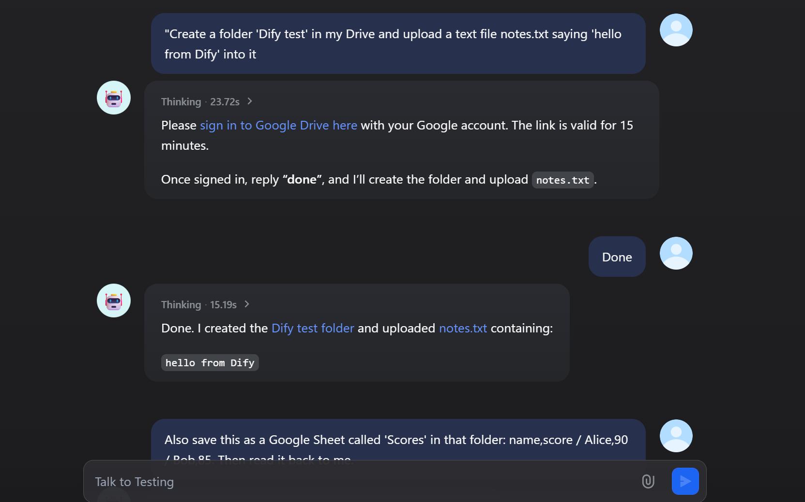
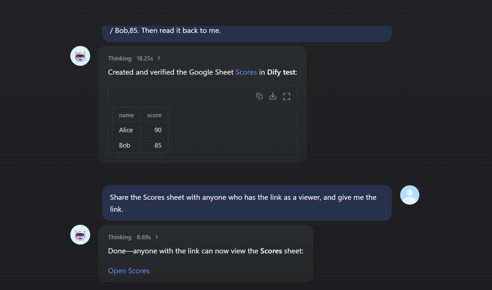

# Google Drive

Search, read, upload, organize and share files in Google Drive and shared drives, from Dify workflows and agents.

This is a **tool** plugin. To import Drive documents into a knowledge base, use the Google Drive **data source** plugin instead.

## Tools

| Area | Tools |
|---|---|
| Find | `google_drive_search`: by name, by content (full text), by type (folders, Docs, Sheets, Slides, PDF), in a folder, recent files, or any Drive query. `google_drive_list_folder`, `google_drive_list_shared_drives` |
| Read | `google_drive_read_text`: a Google Doc as Markdown, a Google Sheet as CSV, a Slides deck or a text file as text. `google_drive_get_file`: details and link |
| Download | `google_drive_download_file`: the file itself (up to 50 MB). Google Docs/Sheets/Slides are exported to PDF, DOCX, XLSX, PPTX, CSV, Markdown, text, HTML or PNG |
| Write | `google_drive_upload_file`: a file, or text written by the agent; can convert it to a Google Doc, Sheet or Slides deck. `google_drive_create_folder`, `google_drive_copy_file`, `google_drive_move_file`, `google_drive_rename_file`, `google_drive_delete_file` (trash, restore or delete permanently) |
| Share | `google_drive_share_file` with a person, a group, a domain or anyone with the link (viewer, commenter, editor). `google_drive_list_permissions`, `google_drive_remove_permission` |
| Sign-in | `google_drive_sign_out` (Each user signs in only) |

All tools work across My Drive and shared drives, and return typed output variables (`success` / `error` plus their fields) for workflows.

## Setup

You need a Google OAuth client:

1. **Create a project**: in the [Google Cloud Console](https://console.cloud.google.com/), create a project (or use an existing one).
2. **Enable the API**: open **APIs & Services › Library** and enable the **Google Drive API**.
3. **Configure Google Auth Platform**:
   - **Branding**: app name and support email.
   - **Audience**: *Internal* for your Google Workspace organization, or *External*. While an External app is in *Testing*, add the people who will sign in as **Test users**.
4. **Create a client**: under **Clients**, create one of type **Web application**. Add the redirect URIs from the modes you use (below), then copy the **Client ID** and **Client Secret**.

The plugin asks for the `https://www.googleapis.com/auth/drive` permission, so it can find and manage all of the user's files. Google classifies it as *restricted*: an External app published for users outside your organization must pass Google's verification. Internal apps and apps in Testing don't need it.

### OAuth (one shared account)

1. In Dify, open the plugin's authorization and choose **OAuth**. Dify shows its redirect URL: `https://<your-dify>/console/api/oauth/plugin/langgenius/google_drive_tool/google_drive_tool/tool/callback`. Add it to the client's **Authorized redirect URIs**.
2. Enter the **Client ID** and **Client Secret**, then authorize with the Google account the plugin should use.

### Each user signs in (for chat agents)

Every chat user signs in with their own Google account, and the tools work on that person's Drive.

1. **Create the sign-in endpoint**: open the plugin's details › **Endpoints** and create an endpoint (no settings). Copy its URL ending in `/google_drive/callback`.
   - If the URL starts with `http://localhost`, set `ENDPOINT_URL_TEMPLATE` on the Dify API service to your public address, e.g. `https://dify.example.com/e/{hook_id}`.
   - Google only accepts `https://` redirect URIs, except for `localhost`.
2. **Register the URL with Google**: add it to the client's **Authorized redirect URIs**. One client can serve several Google plugins.
3. **Add a credential in Dify**: in the plugin's authorization, add an API-key style credential with:
   - **Mode**: *Each user signs in*.
   - **Client ID** and **Client Secret**.
   - **Sign-in Callback URL**: the endpoint URL.
4. **Use it in an agent**: add the Google Drive tools to a chat agent with this credential.

**What users see**:
1. The agent replies with a Google sign-in link.
2. The user picks their account and allows access to Drive. They must keep the box ticked; if the Drive permission is unticked, the plugin asks them to sign in again.
3. The page shows *Signed in*. Back in the chat, the user says they are done.
4. The agent continues and says which account was signed in.

While the app is in *Testing*, Google first shows "Google hasn't verified this app"; click **Continue**.

**Good to know**:
- **Signing out**: asking the agent to sign out of Google Drive (`google_drive_sign_out`) forgets that user's sign-in. Other Google plugins keep their own sign-ins.
- **Signing in again**: users are asked to sign in again when they revoke access (Google Account › Security › Third-party access) or when the Client Secret changes.
  - While the app is in **Testing**, Google expires refresh tokens after 7 days.
- **Security**:
  - The endpoint only stores the one-time authorization code. The tool redeems it with the client secret and a PKCE verifier.
  - Per-user tokens are encrypted with a key derived from the Client Secret and never appear in tool output.
  - File and permission IDs are URL-encoded, so a value chosen by the model cannot change which API is called.

## Troubleshooting

| Message | Fix |
|---|---|
| `Error 403: access_denied` when signing in | The app is in Testing and this account is not a test user. Add it under Google Auth Platform › Audience › **Test users**. |
| `Error 400: redirect_uri_mismatch` | Add the exact endpoint URL (or Dify's OAuth redirect URL) to the client's Authorized redirect URIs. |
| `Google Drive API error 403` mentioning the API | Enable the Google Drive API in the client's project. |
| `… cannot be read as text` | The file isn't a Doc, Sheet, Slides deck or text file. Use `google_drive_download_file`. |
| Export fails for a large Google Doc | Google exports stop at 10 MB. Download it in another format, or split the document. |

## Privacy

See [PRIVACY.md](PRIVACY.md).
