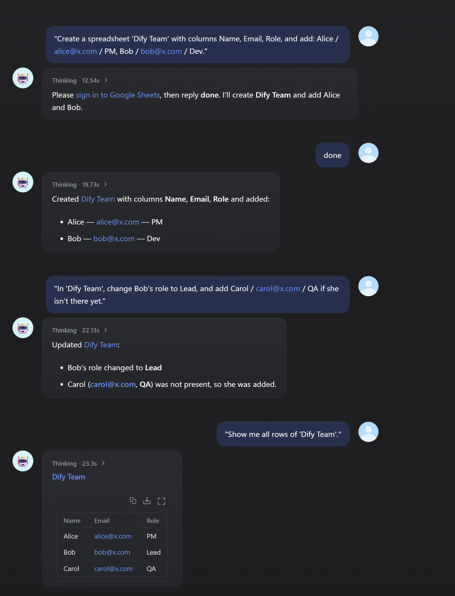

# Google Sheets

Read and write Google Sheets from Dify workflows and agents. Rows can be handled as records keyed by the header row, or cells as raw A1 ranges. The plugin can also create and organize spreadsheets.

## Tools

| Area | Tools |
|---|---|
| Spreadsheets | `google_sheets_find_spreadsheets` (by name), `google_sheets_get_spreadsheet` (title, link, sheets), `google_sheets_create_spreadsheet` (with sheet names and a header row) |
| Rows | `google_sheets_read_rows`, `google_sheets_append_rows`, `google_sheets_update_rows`, `google_sheets_upsert_rows`, `google_sheets_delete_rows` (see below) |
| Ranges | `google_sheets_read_range` (formatted values, raw values or formulas), `google_sheets_write_range` (a grid of values), `google_sheets_clear_range` (keeps formatting) |
| Sheets | `google_sheets_add_sheet`, `google_sheets_rename_sheet`, `google_sheets_delete_sheet` |
| Sign-in | `google_sheets_sign_out` (Each user signs in only) |

The row tools:
- **`read_rows`**: rows as objects such as `{"Name": "Kim", "Score": "90", "row_number": 2}`. Can keep only the rows where a column equals a value.
- **`append_rows`**: rows below the data. On an empty sheet, the keys become the header row.
- **`update_rows`**: changes only the given columns of the rows whose key column matches. It never appends, and reports rows that matched nothing.
- **`upsert_rows`**: updates the rows that match and appends the others.
- **`delete_rows`**: deletes rows by row number, or the rows where a column equals a value.

More details:
- **Spreadsheet IDs**: tools accept the spreadsheet's ID or its URL.
- **Column names** are case-insensitive. Keys that aren't columns yet are an error, unless `add_missing_columns` is on.
- **Values are entered as if typed**, so numbers, dates and `=formulas` behave as in the Sheets UI.
- **Output variables**: every tool returns typed output variables (`success` / `error` plus its fields) for workflows.

## Setup

You need a Google OAuth client:

1. **Create a project**: in the [Google Cloud Console](https://console.cloud.google.com/), create a project (or use an existing one).
2. **Enable the APIs**: open **APIs & Services › Library** and enable the **Google Sheets API** and the **Google Drive API**. Drive is only used to find spreadsheets by name.
3. **Configure Google Auth Platform**:
   - **Branding**: the app name and support email.
   - **Audience**: *Internal* for your Google Workspace organization, or *External*. While an External app is in *Testing*, add the people who will sign in as **Test users**.
4. **Create a client**: under **Clients**, create one of type **Web application**. Add the redirect URIs from the modes you use (below), then copy the **Client ID** and **Client Secret**.

**Permissions** the plugin asks for:
- `spreadsheets`: read and write sheets.
- `drive.metadata.readonly`: find spreadsheets by name; file contents are not read.

`drive.metadata.readonly` is a *restricted* scope. An External app published for users outside your organization must pass Google's verification; Internal apps and apps in Testing don't need it.

### OAuth (one shared account)

1. In Dify, open the plugin's authorization and choose **OAuth**. Add Dify's redirect URL to the client's **Authorized redirect URIs**: `https://<your-dify>/console/api/oauth/plugin/langgenius/google_sheets/google_sheets/tool/callback`.
2. Enter the **Client ID** and **Client Secret**, then authorize with the Google account the plugin should use.

### Each user signs in (for chat agents)

Every chat user signs in with their own Google account, and the tools work on that person's spreadsheets.

1. **Create the sign-in endpoint**: open the plugin's details › **Endpoints** and create an endpoint (no settings). Copy its URL ending in `/google_sheets/callback`.
   - If the URL starts with `http://localhost`, set `ENDPOINT_URL_TEMPLATE` on the Dify API service to your public address, e.g. `https://dify.example.com/e/{hook_id}`.
   - Google only accepts `https://` redirect URIs, except for `localhost`.
2. **Register the URL with Google**: add it to the client's **Authorized redirect URIs**. One client can serve several Google plugins.
3. **Add a credential in Dify**: in the plugin's authorization, add an API-key style credential with:
   - **Mode**: *Each user signs in*.
   - **Client ID** and **Client Secret**.
   - **Sign-in Callback URL**: the endpoint URL.
4. **Use it in an agent**: add the Google Sheets tools to a chat agent with this credential.

**What users see**:
1. The agent replies with a Google sign-in link.
2. The user picks their account and allows access. They must keep both boxes ticked; if a permission is unticked, the plugin asks them to sign in again.
3. The page shows *Signed in*. Back in the chat, the user says they are done.
4. The agent continues and says which account was signed in.

While the app is in *Testing*, Google first shows "Google hasn't verified this app"; click **Continue**.

**Good to know**:
- **Signing out**: asking the agent to sign out of Google Sheets (`google_sheets_sign_out`) forgets that user's sign-in. Other Google plugins keep their own sign-ins.
- **Signing in again**: users are asked to sign in again when they revoke access (Google Account › Security › Third-party access) or when the Client Secret changes.
  - While the app is in **Testing**, Google expires refresh tokens after 7 days.
- **Security**:
  - The endpoint only stores the one-time authorization code. The tool redeems it with the client secret and a PKCE verifier.
  - Per-user tokens are encrypted with a key derived from the Client Secret and never appear in tool output.
  - Spreadsheet IDs and ranges are URL-encoded, so a value chosen by the model cannot change which API is called.

## Troubleshooting

| Message | Fix |
|---|---|
| `Error 403: access_denied` when signing in | The app is in Testing and this account is not a test user. Add it under Google Auth Platform › Audience › **Test users**. |
| `Error 400: redirect_uri_mismatch` | Add the exact endpoint URL (or Dify's OAuth redirect URL) to the client's Authorized redirect URIs, click **Save** at the bottom of the client page, and allow a few minutes for Google to apply it. |
| `Google Sheets API error 403` mentioning the API | Enable the Google Sheets API (and the Google Drive API for finding spreadsheets) in the client's project. |
| `No column '…'` / `Unknown column(s)` | Check the header row (`header_row` if it isn't row 1), or set `add_missing_columns`. |

## Privacy

See [PRIVACY.md](PRIVACY.md).
