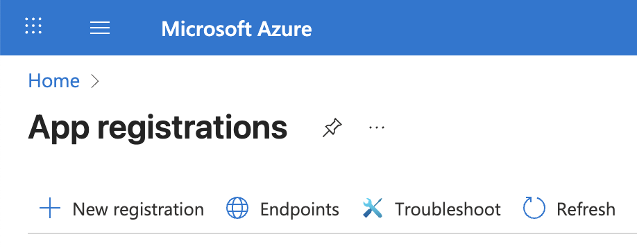
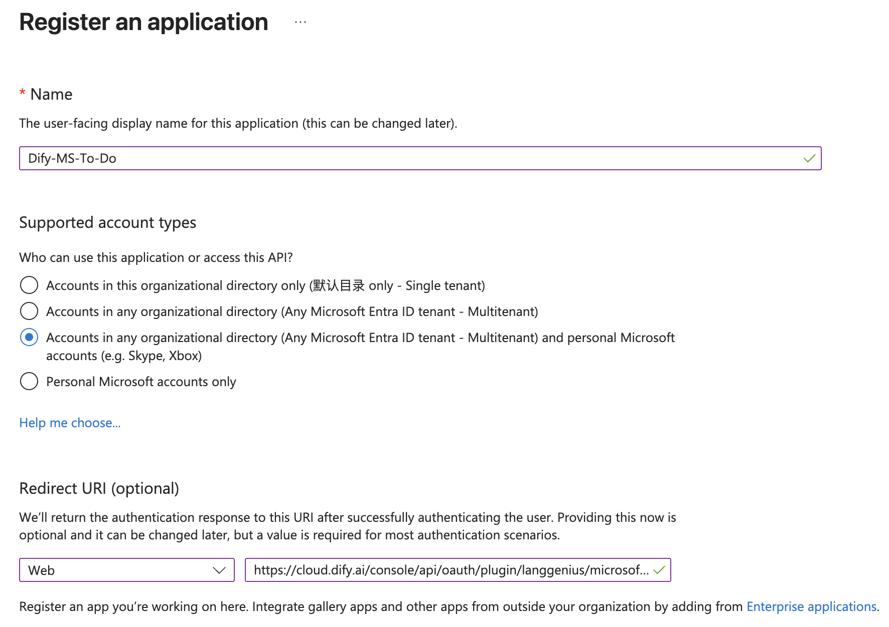
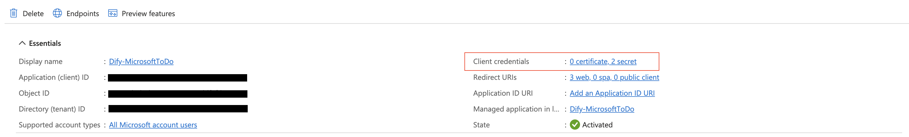
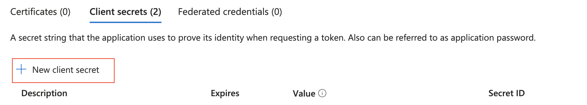
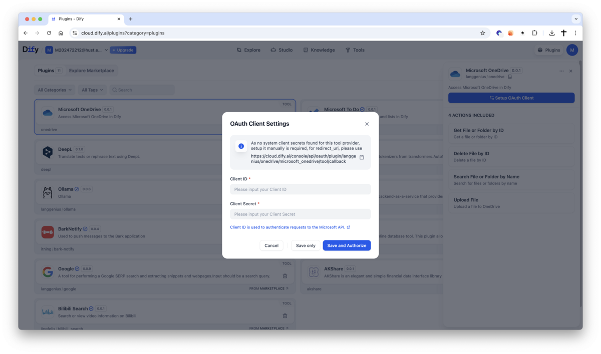
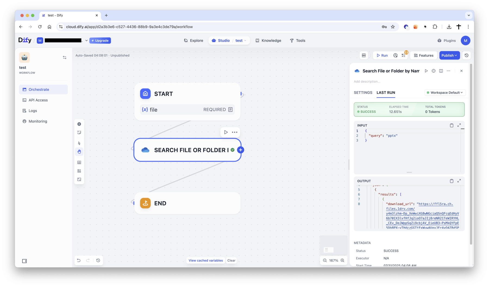

# Microsoft OneDrive Plugin

**Author**: langgenius
**Version**: 0.1.0
**Type**: plugin

## Introduction

This plugin integrates with Microsoft OneDrive, enabling you to search, retrieve, upload, and delete files or folders directly from Dify. It allows automated file management and access to your OneDrive storage through Dify workflows.

## Setup

1. Register your application in the [Microsoft Azure Portal](https://portal.azure.com/#view/Microsoft_AAD_RegisteredApps/ApplicationsListBlade).

<p align="center">
    
</p>

2. Create a new application as follows:
    - **Name**: Dify OneDrive Plugin
    - **Supported account types**: select
        ```
        Accounts in any organizational directory (Any Microsoft Entra ID tenant - Multitenant) and personal Microsoft accounts (e.g. Skype, Xbox)
        ```
    - **Redirect URI**: Choose `Web` and set the URI to:
        - For SaaS (cloud.dify.ai) users: please use
        ```
        https://cloud.dify.ai/console/api/oauth/plugin/langgenius/onedrive/microsoft_onedrive/tool/callback
        ```
        - For self-hosted users: please use
        ```
        http://<YOUR LOCALHOST CONSOLE_API_URL>/console/api/oauth/plugin/langgenius/onedrive/microsoft_onedrive/tool/callback
        ```
        - ***Due to the restrictions of the Microsoft OAuth2 flow, redirect URIs must start with `https://` or `http://localhost`.***
        - Enable "Access tokens" and "ID tokens" under "Implicit grant and hybrid flows"

<p align="center">
        
</p>

3. Copy your **Application (client) ID**

<p align="center">
    
</p>

4. Create a new client secret:
    - **Description**: Dify OneDrive Plugin Secret
    - **Expires**: Whatever duration you prefer (e.g., 1 year, 2 years, etc.)
    - Copy the generated **Value** of the client secret.

<p align="center">
    
</p>

5. Review the delegated Microsoft Graph permissions requested during authorization:
    - `Files.Read.All`: Read files that the signed-in user can access for file retrieval and search.
    - `Files.ReadWrite.All`: Read, create, update, and delete files that the signed-in user can access for upload and delete operations.
    - `Files.ReadWrite.All` applies to every file the signed-in user can access, not only files created through Dify.
    - Review or pre-approve these permissions in Microsoft Entra ID according to your organization's consent policy.
    - See the [Microsoft Graph permissions reference](https://learn.microsoft.com/graph/permissions-reference#filesreadwriteall) for the complete permission definitions.

6. Configure the plugin in Dify:
    - Fill in the **Client ID** and **Client Secret** fields with the values you copied from the Azure Portal.
    - **Tenant ID** (new in 0.1.0): leave it as `common` for a multi-tenant app (or personal accounts). If your app registration is **single-tenant** ("Accounts in this organizational directory only"), enter your directory (tenant) ID or domain; with `common` Microsoft rejects the sign-in with `AADSTS50194`.
    - **Microsoft Cloud** (new in 0.1.0): keep Global unless your tenant is in a national cloud (US Government, US Government DoD, China operated by 21Vianet).
    - Make sure you have the same redirect URI as specified in the Azure Portal. If not, you will need to update it in the Azure Portal.
    - Click `Save and authorize` to initiate the OAuth flow.

7. Enjoy using the Microsoft OneDrive plugin in Dify!

<p align="center">
    
    
</p>


## Service Principal (app-only, new in 0.1.0)

Use this when a workflow should run as the organisation rather than as a person: no user signs in, nothing breaks when someone leaves, and the audit log shows the app.

1. In the app registration, add the Microsoft Graph **Application** permissions (not Delegated) `Files.ReadWrite.All` and, for **Search File or Folder by Name**, `Sites.Read.All` (OneDrive search runs on SharePoint search, which app-only tokens can only use with it), then click **Grant admin consent**. These reach every user's OneDrive in the tenant, so treat the client secret accordingly.
2. In Dify, add an authorization of the **API Key** type and fill in **Tenant ID** (your directory ID, not `common`), **Client ID**, **Client Secret**, **Default Drive Owner** (the user whose OneDrive to use, e.g. `alice@contoso.com`) and **Microsoft Cloud**. Dify signs in and opens that OneDrive to check the permission.
3. Each tool has an optional **Drive Owner** setting (set in the node, never chosen by the LLM) to use another user's OneDrive with the same credential.

The drive owner needs a license that includes OneDrive, and their OneDrive exists only after they have opened it once.

> **Known limitation — search with a Service Principal.** OneDrive search runs on SharePoint search. App-only tokens get `403 accessDenied` from it unless the app also has `Sites.Read.All`, and even with it Microsoft Graph may return an empty result for app-only requests (we saw this in our test tenant, for both drive search and the Microsoft Search API). Upload, Get File by ID and Delete File by ID are not affected. If you need search, use an OAuth authorization.

## Tool Descriptions

### get_file_by_id
Retrieve a file or folder from OneDrive by its ID. For folders, `download` will not return as file.

**Parameters:**
- file_id (string): The ID of the file or folder to retrieve.
- download (boolean, optional): Whether to download the file or not.

### delete_file_by_id
Delete a file from OneDrive by its ID.

**Parameters:**
- file_id (string): The ID of the file to delete.

### search_file
Search for files or folders in OneDrive by name.

**Parameters:**
- query (string): The name of the file or folder to search for.
- limit (number, optional): The maximum number of results to return (default: 10).

### upload_file
Upload a file to the OneDrive root directory; a `file_name` such as `reports/q3.pdf` puts it in that folder.

**Parameters:**
- file (file): The file to upload to OneDrive.
- file_name (string, optional): Custom name for the uploaded file. If not provided, the original file name is used.


## PRIVACY

Please refer to the [Privacy Policy](PRIVACY.md) for information on how your data is handled when using this plugin.

Last updated: October 22, 2026
