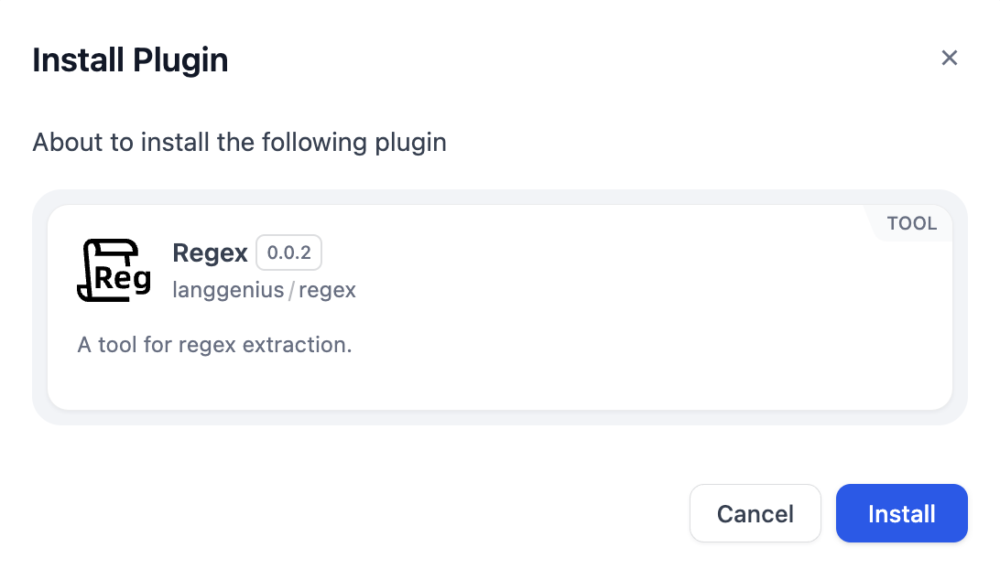

# Overview
The Regex Extract tool is a utility that helps users extract specific patterns of text using regular expressions (regex).
Content and regular expressions are matched exactly as supplied, including significant leading or trailing spaces, tabs, and newlines.

# Configure
1. Install Regex from Dify Marketplace.

2. Fill in Content to be extracted and Regular expression.

