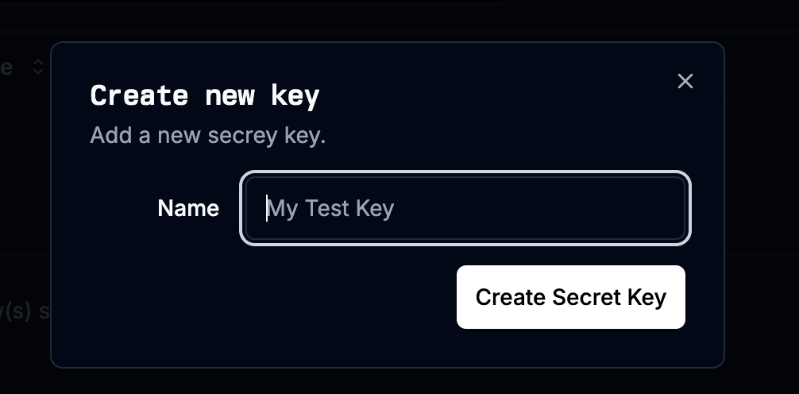
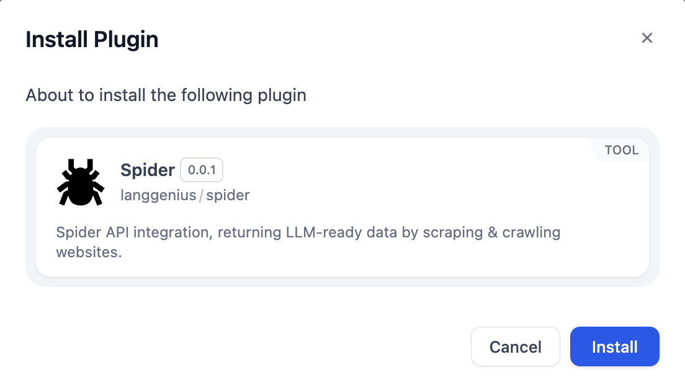

# Spider

## Overview

[Spider](https://spider.cloud/?utm_source=dify&utm_medium=directory&utm_campaign=dify-plugin) is a web crawling and scraping API. This plugin adds one tool, **Web Scraper & Crawler**, that takes a URL and returns the page content as markdown, ready to pass to an LLM node or a knowledge base.

The tool has two modes:

- **scrape** returns one page.
- **crawl** follows links from the URL and returns every page it reaches, up to the limits you set.

## Configure

### Get an API key

1. Create an account at [spider.cloud](https://spider.cloud/?utm_source=dify&utm_medium=directory&utm_campaign=dify-plugin). New accounts can test with 2,500 free credits, worth $0.25, if the signup passes Spider's checks ([FAQ](https://spider.cloud/faq/?utm_source=dify&utm_medium=directory&utm_campaign=dify-plugin)).
2. Create a key at [spider.cloud/api-keys](https://spider.cloud/api-keys?utm_source=dify&utm_medium=directory&utm_campaign=dify-plugin).

### Set up the plugin

1. Install Spider from the Dify Marketplace.

2. Open the Spider plugin's authorization settings in Dify and paste the API key.
3. Add the **Web Scraper & Crawler** tool to a workflow, chatflow or agent.

## Parameters

| Parameter | Default | What it does |
| --- | --- | --- |
| URL | | The page to scrape, or the page a crawl starts from |
| Mode | crawl | `scrape` for one page, `crawl` to follow links |
| Limit | 0 | Maximum pages per crawl. 0 means no limit. |
| Depth | 0 | Maximum link depth for a crawl. 0 means no limit. |
| Readability | false | Run the page through a reader view before converting it to markdown |

Set **Limit** before you crawl a large site. With 0, the crawl keeps going until it runs out of pages or your credit balance runs out.

The output is plain text, with a `URL:` line and a `CONTENT:` block for each page.

## Credits

Each page costs credits. The [pricing page](https://spider.cloud/pricing/?utm_source=dify&utm_medium=directory&utm_campaign=dify-plugin) lists the rates. A `402` response means the account is out of credits. Add more at [spider.cloud/credits/new](https://spider.cloud/credits/new?utm_source=dify&utm_medium=directory&utm_campaign=dify-plugin).

## Links

- [Spider API reference](https://spider.cloud/docs/api?utm_source=dify&utm_medium=directory&utm_campaign=dify-plugin)
- [Spider FAQ](https://spider.cloud/faq/?utm_source=dify&utm_medium=directory&utm_campaign=dify-plugin)
